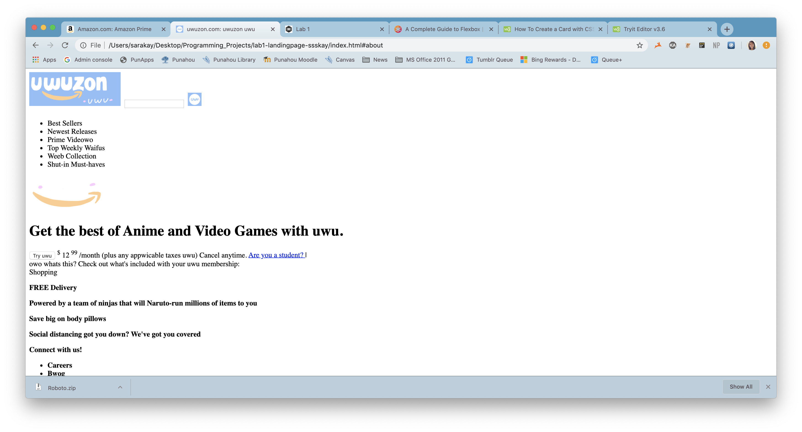

# Uwuzon Prime

A weaboo parody of the Amazon Prime landing page, hand-built in HTML and CSS as my first lab for Dartmouth's CS 52 (spring 2020). [See it live](https://ssskay.github.io/uwuzon-prime/).

What worked: The cta section was probably the easiest to construct since disecting the parts + looking at some of the Amazon CSS was somewhat straightforward. While they don't use flex for positioning, it was easy to see how to layout the parts of text, image and button so it would look presentable. 

What's a work in progress: Getting image positioning correct with flex in the cards.

What didn't work: The Navbar and overall top section is a nightmare to position. I still am unsure about resizing the search bar. Probably should have looked at other sites to "get inspiration" on that since the CSS was pretty useless when I tried implementing/modifying what was there. 

Snippet of the HTML Skeleton:

Inspiration: https://www.amazon.com/amazonprime?_encoding=UTF8&ref_=nav_logo_prime_join

---

Maintained by [Sara Kay](https://sarakay.me) · [@ssskay](https://github.com/ssskay) · [more projects](https://sarakay.me/projects.html)
